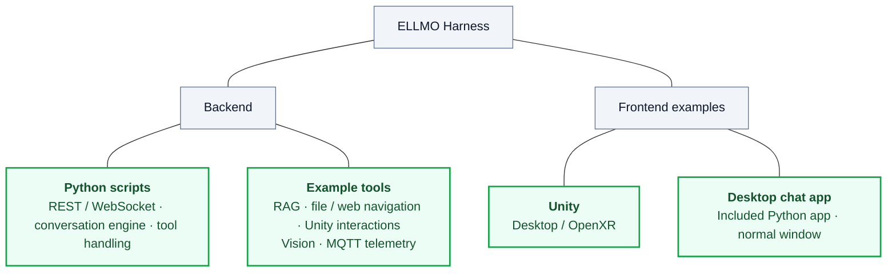

# ELLMO Harness

ELLMO Harness is a research prototype for building inspectable, tool-enabled agent
experiences. Tool calls and results are shown separately so users can inspect the
evidence used by the assistant. The repository includes:

- **Python backend** — connect your own client through REST and WebSocket APIs,
  with shared model, conversation and tool handling. Start with `python run.py` and
  the [service setup](docs/setup.md#restwebsocket-and-unity).
- **Unity example** — explore desktop and OpenXR interactions, including tool-driven
  scene actions, in [`examples/unity-connector/`](examples/unity-connector/).
- **Desktop chat app example** — open a normal window to test your model setup,
  chat, and inspect tool evidence. Run it directly from this repository
  [without Unity](#try-chat-without-unity).
- **Example tools** — extend the assistant with document retrieval, file and web
  access, telemetry, and application actions. See the [tool list](#example-tools)
  for descriptions and setup requirements.

### What is included



## Quick start

Requirements:

- Python 3.13 (with Tk support for the desktop chat app)
- An LLM backend: a local inference engine or a hosted API, configured as below
- The example Unity connector needs Unity 6000.3.11f1

ELLMO connects to a model; it does not include a model or inference engine.
Choose one of these options before starting a chat:

| LLM backend | What you need |
| --- | --- |
| [Ollama](#ollama) | Install Ollama, download a model, and keep its server running. |
| [llama.cpp](#llamacpp) | Install llama.cpp and run `llama-server` with a compatible GGUF model. |
| [OpenAI](#openai) | Set your API key in the `OPENAI_API_KEY` environment variable. List your desired model IDs in the `models` array in your ELLMO configuration file. |
| [OpenRouter](#openrouter) | Set your API key in the `OPENROUTER_API_KEY` environment variable. List your desired full model IDs in the `models` array in your ELLMO configuration file. |

Choose a model with tool/function-calling support to use the example tools. Local
engines need enough RAM/VRAM for your model; hosted APIs require account access and
may charge for usage. The [model backend instructions](#model-backends) below cover
installation, credentials, and the `model_hosts` configuration.

For a quick check in a normal desktop window, use the included
[desktop chat app](#try-chat-without-unity). Install the Python dependencies below;
the desktop app has its own launch command and does not need `python run.py`.

To start the REST/WebSocket backend, run the following from the repository root.
Copy the configuration only on first setup, then configure a
[model backend](#model-backends) before the final `python run.py` command.

```bash
python3.13 -m venv .venv
source .venv/bin/activate
python -m pip install -r requirements.txt
cp backend/config.example.json backend/config.json
python run.py
```

<details>
<summary>Windows PowerShell commands</summary>

```powershell
py -3.13 -m venv .venv
.venv\Scripts\python.exe -m pip install -r requirements.txt
Copy-Item backend/config.example.json backend/config.json
.venv\Scripts\python.exe run.py
```

</details>

For the pinned macOS arm64 dependency set, follow the
[platform-specific installation instructions](docs/setup.md#python-dependencies).

Keep the terminal open while using a client; press **Ctrl+C** to stop the services.
For the desktop chat app, follow [Try chat without Unity](#try-chat-without-unity) below.

### Try chat without Unity

The repository includes a Python desktop chat app at `backend/main.py`. Use it to
check your model connection and send a test message in a normal window. It runs the
conversation engine directly, so you do not need Unity or a separate backend server.

After installing dependencies, create the desktop app's local configuration once
from the repository root:

```sh
cp backend/config.tk.example.json backend/config.tk.json
```

Preserve this file on later launches. Follow [model backend setup](#model-backends)
below to configure your chosen LLM backend, then open the app with the Python
environment activated:

```sh
ELLMO_CONFIG="$PWD/backend/config.tk.json" python backend/main.py
```

In the window that opens, select your configured host and model, type a message,
and send it. A reply confirms that the app can reach your model and complete a chat
turn. The example configuration disables all tools for this first check.
See [desktop app setup](docs/setup.md#desktop-chat-app) for PowerShell commands,
optional message formatting, troubleshooting, and tool limitations.

### Unity desktop and OpenXR

With the backend running, open `examples/unity-connector` in Unity, run the desktop
connector scene and select your configured host and model. The backend listens on
`127.0.0.1:8000` (REST) and `127.0.0.1:8001` (WebSocket) by default.
It currently accepts **one connected client at a time**. Run one WebSocket worker;
extra clients are rejected until the active connection and turn have ended.

If you previously used the desktop app configuration, clear `ELLMO_CONFIG` before
starting the services (`unset ELLMO_CONFIG` in a shell or
`Remove-Item Env:ELLMO_CONFIG` in PowerShell).
See [setup and configuration](docs/setup.md) before enabling models, camera access,
MQTT or document retrieval.

Model weights and manuals are supplied separately. The Siemens example requires
the user to download its source document from Siemens and provide it locally.

You can add speech by connecting your own compatible service, using
[Kokoro](https://github.com/hexgrad/kokoro) or another text-to-speech engine.
Installing Kokoro alone does not supply the Unity client's required HTTP interface.
See [optional speech integration](docs/setup.md#optional-speech) for the interface
and licensing considerations. Speech is disabled by default.

## Example tools

These Python functions in [`backend/tools/`](backend/tools/) show how to connect
the assistant to documents, applications, and external services. Adapt them to
your own use case and enable only the tools you have configured
[via configuration](backend/config.example.json).

The document tools (`query_sinamics_docs` and `query_local_document`) support
retrieval-augmented generation (RAG) with BM25 keyword ranking. At the moment,
they do not use a vector index.

| Tool | What it does | What it needs |
| --- | --- | --- |
| [change_gameobject_color](backend/tools/change_gameobject_color.py) | Changes the example cube's colour using RGB values. | A connected Unity client and the example scene's cube. |
| [change_page](backend/tools/change_page.py) | Moves the Unity document viewer to the next, previous, or requested printed page label. | A connected Unity client and a locally supplied PDF. |
| [query_sinamics_docs](backend/tools/query_sinamics_docs.py) | Searches the Siemens SINAMICS V20 manual and returns relevant excerpts with page citations. | The user-supplied manual and its local search index; see [document setup](backend/tools/query_sinamics_docs/README.md). |
| [query_local_document](backend/tools/query_local_document.py) | Searches one locally configured document and returns cited excerpts. | One PDF, Markdown, or text document; see [document setup](backend/tools/query_local_document/README.md). |
| [get_user_pov](backend/tools/get_user_pov.py) | Captures the user's camera view for a vision-model question, or answers a follow-up about the same image. Virtual overlays are excluded. | **Currently targets Meta Quest 3** running the Unity OpenXR example as a standalone Android app, with camera permission and a configured Ollama vision model. Camera capture is unavailable in the desktop example and Unity Editor. |
| [get_mqtt_telemetry](backend/tools/get_mqtt_telemetry.py) | Summarizes configured numeric sensor readings with optional threshold findings. | An enabled MQTT subscriber and a configured JSON telemetry stream; see [telemetry setup](docs/setup.md#mqtt-telemetry). |
| [get_webpage](backend/tools/get_webpage.py) | Fetches a webpage and turns its HTML into readable text, preserving link references. | A reachable URL; add this helper to your tool configuration. |
| [list_files](backend/tools/list_files.py) | Lists files and folders, optionally exploring a requested number of subfolder levels. | Local filesystem access; add this helper to your tool configuration. |
| [read_file](backend/tools/read_file.py) | Reads a text file or extracts text from a PDF. | A readable local file; add this helper to your tool configuration. |
| [write_file](backend/tools/write_file.py) | Creates a UTF-8 text file, rejecting paths that already exist. | An existing writable parent folder; add this helper to your tool configuration. |

The service example configuration enables `change_gameobject_color`, `change_page`, and
`get_mqtt_telemetry`; the desktop chat example starts with all tools disabled.
The file/web helpers are supplied as source examples and are not registered in
either example configuration. Register them in your local configuration's `tools`
list using their `name`, `module` (for example, `tools.get_webpage`), `function`,
and `enabled` fields. File tools operate with the backend process's filesystem
permissions. See [integration setup](docs/setup.md#optional-integrations) before
enabling document retrieval, camera or MQTT tools.

## Model backends

Choose one option below and configure the file you copied for your client:
`backend/config.tk.json` for the desktop chat app or `backend/config.json`
for the services used by Unity and other clients. Edit its `model_hosts` entries,
keeping the rest of the configuration intact. Restart the desktop app or backend services
after changing configuration or credentials.

The Python requirements include the provider SDKs. OpenAI and OpenRouter are hosted
services; Ollama and llama.cpp need a separately installed server and model files.
Choose a model with tool/function-calling support for the examples.

<a id="openai"></a>

### OpenAI — API key and model selection

Create a key in the [OpenAI API dashboard](https://platform.openai.com/api-keys).
Following the [OpenAI quickstart](https://developers.openai.com/api/docs/quickstart),
set it in the terminal that will launch ELLMO:

```sh
# macOS / Linux
export OPENAI_API_KEY="your-openai-api-key"
```

```powershell
# Windows PowerShell
$env:OPENAI_API_KEY = "your-openai-api-key"
```

Set the existing `OpenAI` entry inside `model_hosts` to:

```json
{
  "provider": "openai",
  "api_key_env": "OPENAI_API_KEY",
  "models": ["gpt-4.1-mini"]
}
```

[`gpt-4.1-mini`](https://developers.openai.com/api/docs/models/gpt-4.1-mini) is an
example; use a Chat Completions model available to your API account. ELLMO uses this
`models` list for the selector rather than fetching OpenAI's model catalog.

Launch ELLMO from the same terminal, then select **OpenAI** and your model.
The environment variable above lasts for that terminal session; set it again in a
new terminal. Keep the key out of JSON files and Git. API usage is billed by the
provider.

<a id="openrouter"></a>

### OpenRouter — API key and model selection

Create a key in [OpenRouter settings](https://openrouter.ai/settings/keys), then set
it in the terminal that will launch ELLMO:

```sh
# macOS / Linux
export OPENROUTER_API_KEY="your-openrouter-api-key"
```

```powershell
# Windows PowerShell
$env:OPENROUTER_API_KEY = "your-openrouter-api-key"
```

Set the existing `OpenRouter` entry inside `model_hosts` to:

```json
{
  "provider": "openrouter",
  "api_key_env": "OPENROUTER_API_KEY",
  "models": ["openai/gpt-4.1-mini"]
}
```

Use the full model ID from [OpenRouter's model catalog](https://openrouter.ai/models),
including its provider prefix. [`openai/gpt-4.1-mini`](https://openrouter.ai/openai/gpt-4.1-mini)
is one example. ELLMO uses the configured list for the selector and supplies
OpenRouter's API base URL automatically; see the
[OpenRouter quickstart](https://openrouter.ai/docs/quickstart) for provider details.

Launch ELLMO from the same terminal, then select **OpenRouter** and your model.
Set the variable again in a new terminal, keep the key out of JSON files and Git,
and check the selected model's pricing and your account balance before use.

<a id="ollama"></a>

### Ollama — install and run a local model

[Download and install Ollama](https://ollama.com/download) for your operating system,
then start its app or service. If you use the CLI without a running app/service,
run `ollama serve` in a separate terminal and leave it running.

Download a model with tool support, such as
[`qwen3:4b`](https://ollama.com/library/qwen3:4b), on the machine running Ollama:

```sh
ollama pull qwen3:4b
ollama ls
```

The second command should list the downloaded model. See the
[Ollama CLI reference](https://docs.ollama.com/cli) for other commands. Model downloads
need disk space, and inference needs enough RAM/VRAM for the model and context size.
The sample ELLMO configuration requests a 32,768-token context; reduce
`context_window_size` if memory is limited.

The example configurations already contain **Ollama - localhost** with
`"provider": "ollama"` and `"host": "http://127.0.0.1:11434"`. Keep that address when
Ollama runs on the same machine as the Python process. No API key is needed for
[local Ollama access](https://docs.ollama.com/api/authentication).

Start ELLMO, select **Ollama - localhost**, then select **qwen3:4b**. ELLMO discovers
installed models from the server and checks their tool support; models without tool
support are excluded from the selectable list. Keep Ollama running while chatting.

<a id="llamacpp"></a>

### llama.cpp — run a local model server

Install [llama.cpp](https://github.com/ggml-org/llama.cpp#installation) and obtain a
compatible GGUF model. Start its
[HTTP server](https://github.com/ggml-org/llama.cpp/tree/master/tools/server) in a
separate terminal, replacing the model path below:

```sh
llama-server -m "/path/to/model.gguf" --jinja --ctx-size 32768 --host 127.0.0.1 --port 8080
```

On Windows, use `llama-server.exe` from your installation. Tool use needs a model
and chat template that support function calling; see llama.cpp's
[tool-calling setup](https://github.com/ggml-org/llama.cpp/blob/master/docs/function-calling.md).
Adjust the context size for your model and memory, and match ELLMO's
`context_window_size` to it. Keep the server running while using ELLMO.

Merge this entry into your local configuration's `model_hosts` object, preserving
any existing hosts:

```json
{
  "llama.cpp - localhost": {
    "provider": "llama-server",
    "base_url": "http://127.0.0.1:8080/v1",
    "api_key_env": "LLAMA_SERVER_API_KEY"
  }
}
```

The local server above needs no API key. If you enable server authentication, set
the matching key in `LLAMA_SERVER_API_KEY` in the terminal that launches ELLMO.
Restart ELLMO, select **llama.cpp - localhost**, and choose a model listed by the
server. ELLMO lists the server's models; that listing does not verify tool support.

### Ollama on another machine — network access and ELLMO configuration

Install Ollama and pull the model on that machine using the instructions above.
In the examples below, replace `OLLAMA_MACHINE_IP` with the Ollama machine's
LAN or VPN IP address and `PYTHON_MACHINE_IP` with the Python machine's address.

**1. Make Ollama listen on the network.** It binds to `127.0.0.1:11434` by default.
On **Windows and macOS**, open the Ollama app on that machine and enable
**Settings → Expose Ollama to the network**.

Alternatively, or for a **Linux systemd service**, set
`OLLAMA_HOST=0.0.0.0:11434` and restart Ollama. Follow the
[official server configuration instructions](https://docs.ollama.com/faq#how-do-i-configure-ollama-server)
for your installation:

- **macOS app:** run `launchctl setenv OLLAMA_HOST "0.0.0.0:11434"`, then quit and
  reopen Ollama.
- **Windows app:** quit Ollama from the system tray, open **Edit environment
  variables for your account**, add `OLLAMA_HOST` with value `0.0.0.0:11434`, then
  reopen Ollama from the Start menu.
- **Linux systemd service:** run `sudo systemctl edit ollama.service` and add:

  ```ini
  [Service]
  Environment="OLLAMA_HOST=0.0.0.0:11434"
  ```

  Save, then run:

  ```sh
  sudo systemctl daemon-reload
  sudo systemctl restart ollama
  ```

**2. Allow access through the Ollama machine's firewall.** Allow inbound TCP port
`11434` from the Python machine's IP only. For example, on Ubuntu with UFW already
enabled, [add a source-restricted rule](https://documentation.ubuntu.com/server/how-to/security/firewalls/):

```sh
sudo ufw allow proto tcp from PYTHON_MACHINE_IP to any port 11434
```

Use the equivalent inbound rule on other firewalls. Ollama's local API
[requires no authentication](https://docs.ollama.com/api/authentication); use a
trusted LAN or VPN and do not expose this port to the internet.

**3. Point ELLMO at the Ollama machine.** In your local ELLMO configuration, update
the existing Ollama entry inside `model_hosts` to:

```json
{
  "provider": "ollama",
  "host": "http://OLLAMA_MACHINE_IP:11434"
}
```

You can rename the entry from `Ollama - localhost` to `Ollama - remote` to make it
easy to recognize in the selector. Use the server's reachable IP or hostname here;
`0.0.0.0` is a listening address, and `127.0.0.1` would refer to the Python machine
itself. This setting controls the connection from Python to Ollama; Unity continues
to connect to ELLMO's REST/WebSocket services.

**4. Check connectivity from the Python machine.**

```sh
# macOS / Linux
curl http://OLLAMA_MACHINE_IP:11434/api/tags
```

```powershell
# Windows PowerShell
Invoke-RestMethod http://OLLAMA_MACHINE_IP:11434/api/tags
```

The response should list the model you pulled. If it fails, check the server address,
Ollama's bind setting and the firewall rule. Restart ELLMO and select the Ollama host
and model once the check succeeds.

## Development

Repository and component guidance for coding agents is in [AGENTS.md](AGENTS.md).
The backend and desktop chat app live in `backend/`; the full Unity project lives in
`examples/unity-connector/`. After installing dependencies and creating the example
configuration, run the backend checks with:

```sh
PYTHONPATH=backend python -B -m unittest discover -s backend/tests -v
```

Keep credentials, user documents, conversation records and generated output local.
Unity compilation, camera/microphone use and XR hardware require separate validation.

## Project status

This is research software, not a production or safety system. It provides no SLA and
must not be relied on for safety-critical decisions or unverified physical actions.

TODO: support multiple simultaneous clients with separate sessions and tool routing.

## License

Project code is licensed under Apache-2.0. Bundled Unity/font assets and fetched
dependencies retain their own licenses; see [third-party notices](THIRD_PARTY_NOTICES.md).
